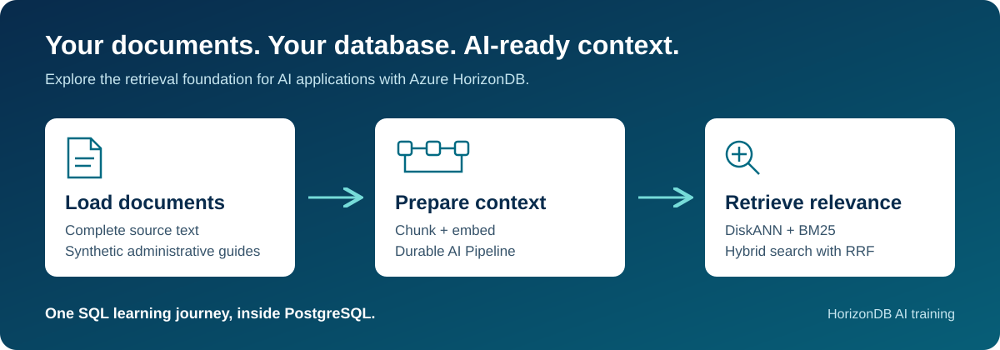

# HorizonDB AI training

### From documents to relevant answers, starting with better retrieval.

Build the retrieval foundation for AI assistants using **Azure HorizonDB and SQL**.
This guided training takes you from complete source documents to searchable
chunks, embeddings, and ranked results, without building a separate ingestion
service for the walkthrough.

**[Start the hands-on lab](horizondb-lab.md)** ·
**[Open the SQL walkthrough](horizondb-ai-sql-queries-only.sql)** ·
**[Explore HorizonDB](https://learn.microsoft.com/en-us/azure/horizondb/)**

## Why HorizonDB for AI?

Useful AI applications need relevant, up-to-date context, not just a model.
HorizonDB brings document preparation and complementary search techniques into
PostgreSQL, so you can work with your data and retrieval logic through SQL.

| What your application needs | What you will explore |
| --- | --- |
| Understand meaning, not only exact words | Embeddings and **DiskANN vector search** for semantic similarity |
| Find precise terms and phrases | **BM25 full-text search** with `pg_textsearch` |
| Combine semantic and keyword relevance | **Hybrid retrieval** using reciprocal rank fusion (RRF) |
| Turn source documents into searchable context | **AI Pipelines** that chunk and embed documents |
| Use embeddings without wiring a separate model endpoint in the lab | **AI Model Management** and registered embedding models |
| Run document preparation durably | Pipeline execution and status inspection backed by `pg_durable` |

This is a small, functional learning exercise, **not a performance benchmark**.
The sample data demonstrates how the pieces connect; it does not establish
production-scale latency, recall, or throughput.

## What this training is based on

The training follows the two files included in this repository:

| File | Purpose |
| --- | --- |
| [`horizondb-lab.md`](horizondb-lab.md) | Guided instructions, prerequisites, explanations, and SQL blocks |
| [`horizondb-ai-sql-queries-only.sql`](horizondb-ai-sql-queries-only.sql) | The companion SQL, arranged in the same eight parts |

Synced with the [AI pipelines documentation](https://learn.microsoft.com/en-us/azure/horizondb/ai/ai-pipelines) updated November 17, 2026. The examples require **`azure_ai` 2.5.6 or later**, use `ai.chunk_step` / `ai.embed_step` for deferred pipeline work, and use `ai.embed` for immediate query embeddings. See the lab's version checks and upgrade guidance; existing stored pipelines do not need to be recreated for these renames.

Both walkthroughs use the managed `default-embedding` model and identical SQL. For BYOM, follow the lab's optional setup guidance in approved local tooling and replace the model alias consistently; no endpoint or key configuration is embedded in this repository.

The scenario is a **generic workplace document-retrieval exercise** using six
complete, synthetic documents: meeting-room booking, visitor parking, and
archived-project-document requests for two fictional teams.

You will use a dedicated `training_ai_lab` schema, load the source documents into
`training_documents`, and build searchable chunks in `document_chunks`. The pipeline
uses 512-size chunks with 128 overlap and 1,536-dimensional embeddings.

> **Synthetic content only.** The examples contain no real customer documents or
> personal information. This is a retrieval lab, not a
> complete answer-generating application.

## Your hands-on journey

| Part | Activity | What to look for |
| --- | --- | --- |
| 1 | Verify extensions and registered models | Required extensions are present and an embedding model is available |
| 2 | Load the six complete documents | Source text and team membership are stored before chunking |
| 3 | Create and run a durable AI Pipeline | Documents are chunked and embedded; the run completes successfully |
| 4 | Inspect the searchable output | Each chunk has a batch-local document number, chunk index, text, and a 1,536-dimensional embedding |
| 5 | Build a DiskANN index and run vector search | Semantically similar chunks are retrieved by cosine distance |
| 6 | Build a BM25 index and run keyword search | Chunks are ranked by keyword relevance |
| 7 | Combine both searches using RRF | Up to 50 candidates from each search contribute to the top 10 results |
| 8 | Review an optional `ai.search` example | Verify the installed signature, indexes, match types, and scores |

The final example is **optional and commented out in the SQL file**.
Verify the `ai.search` contract on your HorizonDB build before running it.

## Before you begin

You need an Azure subscription with access to HorizonDB and permission to
configure the cluster and create database objects. Azure resources and model
usage may incur charges.

1. **Create a dedicated lab cluster and database.**
   Follow the [cluster quickstart](https://learn.microsoft.com/en-us/azure/horizondb/configure-maintain/quickstart-create-cluster)
   and allow your client IP through the cluster's networking configuration.
2. **Enable AI Model Management.**
   Follow the [model-management setup](https://learn.microsoft.com/en-us/azure/horizondb/ai/ai-model-management#enable-ai-model-management).
   The lab checks the registered models before creating embeddings.
3. **Configure the required extensions.**
   Follow the lab guide's parameter-group instructions: allow all five required
   extensions in `azure.extensions`, and add both `pg_durable` and `pg_textsearch` to
   `shared_preload_libraries`, preserving existing values.
   The lab uses `vector`, `pg_diskann`, `pg_textsearch`, `pg_durable`, and `azure_ai`.
4. **Connect from VS Code or your SQL client.**
   The [PostgreSQL extension for VS Code](https://learn.microsoft.com/en-us/azure/horizondb/development/vs-code-extension/vs-code-connect)
   provides the connection experience used in the training.

Then open **[the lab guide](horizondb-lab.md)** and execute its SQL blocks
individually, in order, against the same database connection.

> **Run safely:** Connect to the primary (read-write) endpoint and keep autocommit enabled. Do not execute the entire script as
> one transaction. Parts 1-3 create persistent objects, and pipeline names are
> database-wide: do not blindly rerun setup. Stop on errors, and wait for the
> durable pipeline run to commit and complete successfully before Part 4.
> Empty output alone is not evidence that the pipeline succeeded.

> **Source and sink:** Even a manual pipeline requires an incremental column. This insert-only lab uses the source identity `id`; updates need an advancing revision/timestamp watermark. During preview, chunk `doc_id` is batch-local, not the source primary key, and chunking drops source metadata such as `team_id`. Run once into an empty sink, validate text, dimensions, and chunk identity, and do not use `doc_id` for attribution or authorization. A completed status alone does not guarantee valid output.

Never put passwords, connection strings, access tokens, endpoints, or API keys
in committed files. Keep connection settings in your approved local tooling.

## Try questions that reveal different retrieval behavior

Use the supplied meeting-room query first. Then experiment with alternatives
such as these, changing the query text consistently in both branches of the
hybrid example:

| Example question | What to explore |
| --- | --- |
| "How do I book a meeting room?" | Compare the booking passages returned by vector, BM25, and hybrid search |
| "Where can visitors park?" | Look for the parking document even when the question paraphrases the source |
| "How do I request an archived project document?" | Inspect keyword relevance for a specific administrative task |
| "Does submitting a room booking request confirm my reservation?" | Check whether retrieved passages contain the distinction needed to answer |

Inspect the returned passages rather than assuming any search method will
always produce the best result. The sample intentionally includes different
Team A and Team B room-booking workflows.

## Where these patterns can help

These are **application ideas**, not additional implemented labs:

| Use case | How the training pattern applies |
| --- | --- |
| Administrative self-service | Retrieve room-booking, parking, and archive-request guidance from approved documents |
| Customer-support copilots | Combine exact product terms with semantic matches across help-center articles |
| Internal knowledge assistants | Retrieve relevant policy, onboarding, and operational documentation |
| Product-documentation search | Blend keyword precision with natural-language questions about features |
| Agent grounding | Supply retrieved passages as context to an application-side model or agent |

## What you still need for production

The walkthrough intentionally stops at ranked retrieval results.

- **Authorization and isolation:** The sample hybrid query is unfiltered.
  Enforce tenant, team, and user-access boundaries before using
  retrieved content to personalize answers.
- **Answer generation and citations:** Add application-side prompts, source
  attribution, and appropriate handling when evidence is missing or conflicting.
- **Evaluation:** Measure relevance, recall, latency, cost, chunk quality, and
  freshness against your own documents and representative questions.
- **Safety and operations:** Add appropriate application-safety controls,
  monitoring, governance, and a tested ingestion/update lifecycle.
  Preserve the active sink when rebuilding; validate staging output before replacement.

## Learn more

- [Azure HorizonDB documentation](https://learn.microsoft.com/en-us/azure/horizondb/)
- [AI Model Management](https://learn.microsoft.com/en-us/azure/horizondb/ai/ai-model-management)
- [AI pipelines](https://learn.microsoft.com/en-us/azure/horizondb/ai/ai-pipelines)
- [AI search](https://learn.microsoft.com/en-us/azure/horizondb/ai/ai-search)
- [Migrate AI functions to the ai schema](https://learn.microsoft.com/en-us/azure/horizondb/ai/migrate-ai-schema)
- [BM25 full-text search and extension setup](https://learn.microsoft.com/en-us/azure/horizondb/ai/full-text-search)
- [Connect using VS Code](https://learn.microsoft.com/en-us/azure/horizondb/development/vs-code-extension/vs-code-connect)

Feature availability and SQL interfaces can vary by HorizonDB build and region.
Use the linked documentation and the checks in the lab guide for your environment.
